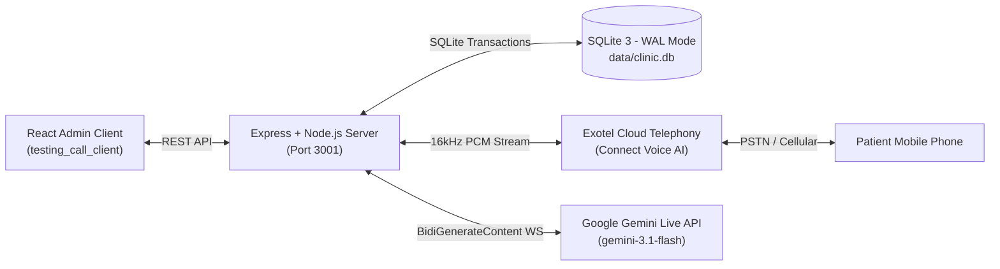

# Apex Multispecialty Hospital — Real-Time AI Outbound Voice Telephony System

> **Note**: For dedicated server documentation, see [`server-readme.md`](file:///home/cm113/Downloads/testing_call/server-readme.md). For dedicated client documentation, see [`testing_call_client/client-readme.md`](file:///home/cm113/Downloads/testing_call/testing_call_client/client-readme.md).

A full-duplex, real-time conversational AI phone calling and admin dashboard system. The application bridges **Exotel Cloud Telephony (Connect Voice AI)** with **Google Gemini's Multimodal Live API (`BidiGenerateContent`)**, a local **relational SQLite clinical database (WAL mode)**, and a **modern React admin dashboard** to conduct context-aware, low-latency, two-way voice conversations across cellular networks.

---

## Table of Contents
1. [Product Overview](#product-overview)
2. [Key Features](#key-features)
3. [Architecture & Tech Stack](#architecture--tech-stack)
4. [Hospital Departments Supported](#hospital-departments-supported)
5. [End-to-End Workflow](#end-to-end-workflow)
6. [Core Server Components](#core-server-components)
7. [Frontend Client Portal](#frontend-client-portal)
8. [Database Schema](#database-schema)
9. [Audio Pipeline & DSP Mechanics](#audio-pipeline--dsp-mechanics)
10. [Environment Configuration (.env)](#environment-configuration-env)
11. [Setup & Running Locally](#setup--running-locally)
12. [API Reference](#api-reference)

---

## Product Overview

* **Use Case**: Automated patient care navigator and appointment booking assistant (**"Maya"**) for **Apex Multispecialty Hospital**.
* **Role**: Conducts both outbound follow-up calls to patients and answers inbound phone calls from patients and new callers. Before dialing or upon answering, the system **looks up the patient's active medical history, last visit details, pending clinical actions, and doctor's schedule from SQLite**, then dynamically customizes Maya's personality, greeting, clinical context, and available appointment openings.
* **Telephony Provider**: [Exotel](https://exotel.com) (Connect Voice AI bidirectional streaming over WebSockets).
* **AI Engine**: Google Gemini Multimodal Live API (`gemini-3.1-flash-live-preview`) using WebSocket bidirectional streaming with synthetic voice output (`Puck` / `Vega`).
* **Database**: Local SQLite database with Write-Ahead Logging (`WAL`) mode, storing patients, clinical contexts, doctors, live appointment slots, confirmed bookings, and turn-by-turn dialogue transcripts.
* **Admin Portal**: Modern React 18 + Vite + Tailwind CSS dashboard (`testing_call_client`) providing one-click calling, transcript review, slot management, and live system health monitoring.

---

## Key Features

1. **Multispecialty Care Coordination & Dual-Direction Telephony**:
   Full support for both **Outbound Care Coordination** and **Inbound Patient Navigation** across 7 medical departments: Cardiology, Ophthalmology, ENT, Hepatology, Dental & Maxillofacial, Orthopedics, and General Medicine. Inbound callers are greeted warmly, recognized from clinical records, and auto-registered upon spoken self-introduction.
2. **Zero-Latency Pre-Warming Engine**:
   Pre-warms the Gemini WebSocket connection and pre-synthesizes greeting audio while the patient's phone is ringing, eliminating initial silence when the user answers.
3. **Conversational Audio Fillers**:
   Seamlessly injects natural filler phrases (*"Let me check the doctor's schedule for you..."*, *"One moment please, locking in your appointment..."*) while executing database transactions, keeping callers engaged.
4. **Real-time Name Detection & Auto-Registration**:
   Detects caller self-introductions in live speech (*"I am Aman"*, *"This is Rahul"*) and automatically registers their profile in the database.
5. **Turn-by-Turn Dialogue Transcripts**:
   Logs complete conversation transcripts with speaker tags, timestamps, and clinical summaries in SQLite.
6. **Robust Multi-Patient Test Phone Correlation**:
   Resolves patient identity using Call SIDs and Exotel `CustomField` markers, allowing multiple demo patients to safely share a single developer test phone number.

---

## Architecture & Tech Stack



* **Backend**: Node.js (ES Modules), Express.js, `ws` (WebSockets), `better-sqlite3`.
* **Frontend**: React 18, Vite, Tailwind CSS, Lucide React icons.
* **AI Model**: Google Gemini Live Multimodal WebSocket API.
* **Telephony**: Exotel Connect Voice AI (Bidirectional Audio Streaming).
* **Audio Format**: 16 kHz, 16-bit Linear PCM (Exotel) <-> 24 kHz Linear PCM (Gemini).

---

## Hospital Departments Supported

1. **Cardiology**: Interventional cardiology, coronary stents, ECG follow-ups, blood thinner adherence.
2. **Ophthalmology**: Cataract review, visual acuity checks, eye pressure monitoring, postoperative eye drops.
3. **ENT (Ear, Nose & Throat)**: Endoscopic sinus surgery (FESS), airway inspection, nasal breathing assessments.
4. **Hepatology & Gastroenterology**: Liver cirrhosis, FibroScan scheduling, hepatitis surveillance, digestive health.
5. **Dental & Maxillofacial**: Root canals, permanent zirconia crowns, oral surgery healing, biting comfort.
6. **Orthopedics**: Total knee arthroplasty, joint mobility, physiotherapy follow-ups, sports injury recovery.
7. **General Medicine**: Routine wellness evaluations, diabetic reviews, seasonal health checkups.

---

## Setup & Quick Start

### 1. Environment Configuration
Create `.env` in the root folder:
```env
PORT=3001
GEMINI_API_KEY=your_gemini_api_key
GEMINI_MODEL=gemini-3.1-flash-live-preview
GEMINI_VOICE=Puck

EXOTEL_API_BASE_URL=https://api.exotel.com
EXOTEL_ACCOUNT_SID=your_exotel_sid
EXOTEL_API_KEY=your_exotel_key
EXOTEL_API_TOKEN=your_exotel_token
EXOTEL_CALLER_ID=08047289577

PUBLIC_WSS_URL=wss://your-ngrok-tunnel.ngrok-free.app/exotel/media
TEST_PHONE_NUMBER=+918218627040
CLEAR_DB=false
```

### 2. Start the Backend Server
```bash
npm install
npm run db:reset    # Initialize and seed database
npm start           # Starts server on port 3001
```

### 3. Start the Admin Frontend
```bash
cd testing_call_client
npm install
npm run dev         # Starts React portal on http://localhost:5173
```

---

## Documentation Links
* 📘 **[Server Complete Documentation (server-readme.md)](file:///home/cm113/Downloads/testing_call/server-readme.md)**: In-depth technical architecture, DSP mechanics, Gemini Live tool calling schemas, and database queries.
* 🖥️ **[Client Complete Documentation (client-readme.md)](file:///home/cm113/Downloads/testing_call/testing_call_client/client-readme.md)**: Frontend architecture, service layers, component hierarchy, UI workflows, and state management.
