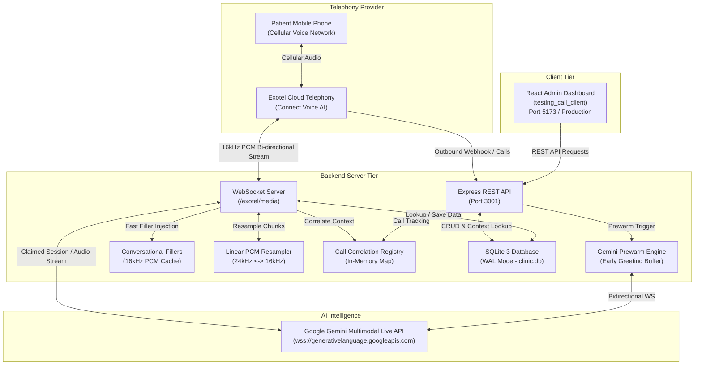
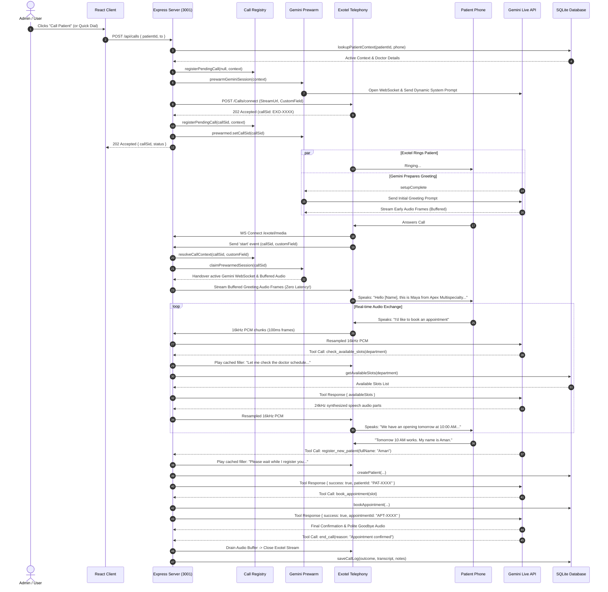

# Apex Multispecialty Hospital — Backend Voice AI Server (`server-readme.md`)

A high-performance, full-duplex conversational voice telephony server powering **Maya**, the AI Patient Care Navigator for **Apex Multispecialty Hospital**.

The system bridges **Exotel Cloud Telephony (Connect Voice AI)** with **Google Gemini Multimodal Live API (`BidiGenerateContent`)** and a local **relational SQLite database (WAL mode)** to deliver real-time, low-latency, context-aware phone consultations over cellular networks.

---

## Table of Contents
1. [Architecture & System Overview](#1-architecture--system-overview)
2. [End-to-End System Workflow](#2-end-to-end-system-workflow)
3. [Repository Directory & File Structure](#3-repository-directory--file-structure)
4. [Relational Database Schema & Data Models](#4-relational-database-schema--data-models)
5. [Core Server Components & Deep-Dive](#5-core-server-components--deep-dive)
   - [5.1 Server Entry (`src/server.js`)](#51-server-entry-srcserverjs)
   - [5.2 REST API Router (`src/routes/outboundCalls.js`)](#52-rest-api-router-srcroutesoutboundcallsjs)
   - [5.3 Call Identity & Session Registry (`src/telephony/callRegistry.js`)](#53-call-identity--session-registry-srctelephonycallregistryjs)
   - [5.4 Zero-Latency Pre-Warming Engine (`src/telephony/geminiPrewarm.js`)](#54-zero-latency-pre-warming-engine-srctelephonygeminiprewarmjs)
   - [5.5 Full-Duplex Telephony WebSocket (`src/telephony/exotelMedia.js`)](#55-full-duplex-telephony-websocket-srctelephonyexotelmediajs)
   - [5.6 Shared Gemini Tools & Contracts (`src/telephony/geminiTools.js`)](#56-shared-gemini-tools--contracts-srctelephonygeminitoolsjs)
   - [5.7 Dynamic System Prompt Engine (`src/telephony/promptBuilder.js`)](#57-dynamic-system-prompt-engine-srctelephonypromptbuilderjs)
   - [5.8 Conversational Filler DSP & Cache (`src/audio/fillers.js`)](#58-conversational-filler-dsp--cache-srcaudiofillersjs)
   - [5.9 High-Fidelity Audio DSP Resampler (`src/audio/pcm.js`)](#59-high-fidelity-audio-dsp-resampler-srcaudiopcmjs)
   - [5.10 Database Layer & Transactions (`src/db/database.js`)](#510-database-layer--transactions-srcdbdatabasejs)
6. [How the Client Interacts with the Server](#6-how-the-client-interacts-with-the-server)
7. [Gemini Live Tool Calling Protocol](#7-gemini-live-tool-calling-protocol)
8. [Environment Configuration (`.env`)](#8-environment-configuration-env)
9. [Installation & Deployment Guide](#9-installation--deployment-guide)
10. [Troubleshooting & Edge Cases](#10-troubleshooting--edge-cases)

---

## 1. Architecture & System Overview

The voice assistant architecture consists of 4 distinct operational tiers:



### Core Responsibilities:
1. **Exotel Telephony**: Places outbound PSTN/cellular calls and establishes bidirectional audio WebSocket streams with the backend.
2. **Backend Server (`testing_call`)**: Orchestrates the call lifecycle, synchronizes SQLite data with live prompts, manages bidirectional audio transcoding, caches conversational fillers, and coordinates real-time function calls.
3. **Google Gemini Live API**: Receives live audio from the patient, processes speech understanding, executes tool calls against SQLite, and streams back real-time synthesized audio turns.
4. **Local SQLite Database**: Stores 7 hospital departments, doctors, appointment slots, patient clinical records, and turn-by-turn call transcripts.

---

## 2. End-to-End System Workflow



---

## 3. Repository Directory & File Structure

```
/home/cm113/Downloads/testing_call/
├── data/
│   └── clinic.db                         # Local SQLite Relational Database (WAL mode)
├── src/
│   ├── audio/
│   │   ├── fillers/                      # Native Gemini audio filler clips (24kHz PCM)
│   │   │   ├── booking.pcm               # "One moment please, locking in your appointment..."
│   │   │   ├── checking_slots.pcm        # "Let me check the doctor's schedule for you..."
│   │   │   └── registering.pcm           # "Please wait a moment while I register you..."
│   │   ├── fillers.js                    # Pre-resampled 16kHz PCM memory cache & player
│   │   └── pcm.js                        # Linear interpolation PCM16 resampler (24kHz <-> 16kHz)
│   ├── db/
│   │   ├── clearDb.js                    # CLI utility to wipe and reseed database
│   │   ├── database.js                   # Better-sqlite3 transactional queries & CRUD logic
│   │   ├── reset.js                      # Shortcut runner for clearDb.js
│   │   ├── schema.js                     # DDL Schema, tables, and lookup contracts
│   │   └── seedData.js                   # Initial seeds (7 hospital departments, doctors, slots, patients)
│   ├── routes/
│   │   └── outboundCalls.js              # Express REST router for calls, patients, appointments, slots
│   ├── telephony/
│   │   ├── callRegistry.js               # Multi-patient in-memory session correlation map
│   │   ├── exotelMedia.js                # Full-duplex WebSocket server on /exotel/media
│   │   ├── geminiPrewarm.js              # Early WebSocket connection & audio greeting pre-warmer
│   │   ├── geminiTools.js                # Shared Gemini function calling declarations
│   │   └── promptBuilder.js              # Dynamic system instructions & clinical rules engine
│   └── server.js                         # Application entrypoint & HTTP/WS server bootstrap
├── testing_call_client/                  # Independent React Admin Dashboard (Vite + Tailwind)
├── .env                                  # Secret keys, API tokens, and telephony configuration
├── package.json                          # Node dependencies and project scripts
├── server-readme.md                      # Complete Backend Documentation (this file)
└── README.md                             # Root system documentation
```

---

## 4. Relational Database Schema & Data Models

The database resides in `data/clinic.db` and operates with SQLite **WAL (Write-Ahead Logging)** mode for concurrent readers and zero-lock transactions.

### 4.1 Tables Definition (`src/db/schema.js`)

#### 1. `patients`
Stores registered hospital patients and demographics.
```sql
CREATE TABLE IF NOT EXISTS patients (
  patient_id TEXT PRIMARY KEY,               -- e.g. 'PAT-1042', 'PAT-2002'
  phone TEXT NOT NULL,                      -- E.164 phone string (e.g. '+918218627040')
  full_name TEXT NOT NULL,                  -- Patient legal name (e.g. 'Aman Gupta')
  preferred_name TEXT NOT NULL,             -- Addressing name (e.g. 'Aman')
  age INTEGER,                              -- Patient age
  gender TEXT,                              -- 'Male', 'Female', 'Other'
  assigned_doctor_id TEXT,                  -- Default specialist doctor
  medical_alerts TEXT,                      -- JSON array: '["Penicillin Allergy", "Hypertension"]'
  insurance_plan TEXT,                      -- Insurance policy details
  preferred_time_of_day TEXT DEFAULT 'Morning',
  general_notes TEXT,                       -- Clinical background
  created_at TEXT DEFAULT (datetime('now'))
);
```

#### 2. `active_contexts`
Stores the active clinical state and reason for the upcoming call.
```sql
CREATE TABLE IF NOT EXISTS active_contexts (
  context_id TEXT PRIMARY KEY,              -- e.g. 'CTX-1042'
  patient_id TEXT NOT NULL,
  call_goal TEXT NOT NULL,                  -- e.g. 'POST_PROCEDURE_FOLLOW_UP'
  call_reason TEXT NOT NULL,                -- Clinical rationale explained to patient
  last_visit_date TEXT,                     -- '2026-10-14'
  last_visit_procedure TEXT,                -- 'Coronary Angioplasty with Stent'
  last_visit_doctor TEXT,                   -- 'Dr. Rajesh Sharma'
  last_visit_outcome TEXT,                  -- 'Successful stent placement; monitor chest comfort'
  pending_action TEXT NOT NULL,             -- 'Schedule 30-day cardiac stress echocardiogram'
  recommended_duration_minutes INTEGER DEFAULT 30,
  urgency TEXT DEFAULT 'MEDIUM',            -- 'LOW', 'MEDIUM', 'HIGH', 'CRITICAL'
  is_active INTEGER DEFAULT 1,              -- 1 if context is current
  created_at TEXT DEFAULT (datetime('now')),
  FOREIGN KEY(patient_id) REFERENCES patients(patient_id)
);
```

#### 3. `doctors`
Contains specialist physicians across the 7 hospital departments.
```sql
CREATE TABLE IF NOT EXISTS doctors (
  doctor_id TEXT PRIMARY KEY,               -- e.g. 'DOC-CARD', 'DOC-ENT', 'DOC-EYE'
  name TEXT NOT NULL,                       -- 'Dr. Rajesh Sharma'
  specialty TEXT NOT NULL,                  -- 'Senior Interventional Cardiologist'
  department TEXT NOT NULL,                 -- 'Cardiology', 'ENT', 'Ophthalmology', etc.
  available_days TEXT                       -- 'Monday through Friday'
);
```

#### 4. `appointment_slots`
Maintains doctor schedule blocks.
```sql
CREATE TABLE IF NOT EXISTS appointment_slots (
  slot_id TEXT PRIMARY KEY,                 -- e.g. 'SLOT-CARD-1'
  doctor_id TEXT NOT NULL,
  date TEXT NOT NULL,                       -- '2026-10-31'
  time TEXT NOT NULL,                       -- '10:00 AM'
  is_available INTEGER DEFAULT 1,           -- 1 = Open, 0 = Reserved
  FOREIGN KEY(doctor_id) REFERENCES doctors(doctor_id)
);
```

#### 5. `appointments`
Recorded patient appointments.
```sql
CREATE TABLE IF NOT EXISTS appointments (
  appointment_id TEXT PRIMARY KEY,          -- e.g. 'APT-392811'
  patient_id TEXT NOT NULL,
  doctor_id TEXT NOT NULL,
  department TEXT DEFAULT 'General Medicine',
  date TEXT NOT NULL,
  time TEXT NOT NULL,
  treatment_type TEXT NOT NULL,             -- 'Cardiology Review', 'Cataract Follow-up'
  status TEXT DEFAULT 'SCHEDULED',          -- 'SCHEDULED', 'CONFIRMED', 'COMPLETED'
  notes TEXT,                               -- Booking notes
  created_at TEXT DEFAULT (datetime('now')),
  FOREIGN KEY(patient_id) REFERENCES patients(patient_id),
  FOREIGN KEY(doctor_id) REFERENCES doctors(doctor_id)
);
```

#### 6. `call_logs`
Stores complete call history, metadata, call direction, and turn-by-turn dialogue transcripts.
```sql
CREATE TABLE IF NOT EXISTS call_logs (
  call_sid TEXT PRIMARY KEY,                -- Exotel Call SID
  phone TEXT NOT NULL,
  patient_id TEXT,
  direction TEXT DEFAULT 'OUTBOUND',        -- 'OUTBOUND' or 'INBOUND'
  call_reason TEXT,
  started_at TEXT DEFAULT (datetime('now')),
  ended_at TEXT,
  outcome TEXT,                             -- 'APPOINTMENT_SCHEDULED', 'COMPLETED', etc.
  notes TEXT,                               -- Outcome summary
  transcript_summary TEXT                   -- Formatted timestamped dialogue
);
```

---

## 5. Core Server Components & Deep-Dive

### 5.1 Server Entry (`src/server.js`)
* Initializes HTTP Server and attaches the WebSocket server (`registerExotelMedia`).
* Configures CORS middleware allowing cross-origin requests from the React admin frontend (`testing_call_client`).
* Supports `CLEAR_DB=true` or `CLEAR_DB=1` environment variables to automatically reset and reseed the SQLite database during debug startup.
* Provides `/health` and `/api/health` system diagnostics checking Gemini and Exotel environment readiness.

### 5.2 REST API Router (`src/routes/outboundCalls.js`)
Exposes the complete backend API consumed by the admin client:

| HTTP Method | Route | Description |
|---|---|---|
| `GET` | `/health`, `/api/health` | Returns service health, Exotel configuration, and Gemini credentials status |
| `GET` | `/api/context` | Looks up active patient record and clinical history by `?patientId` or `?phone` |
| `GET` | `/api/patients` | Returns all registered patients, assigned doctors, and active clinical contexts |
| `GET` | `/api/patients/:id` | Returns single patient profile with doctor and appointment history |
| `POST` | `/api/patients` | Manually creates a new patient and clinical follow-up profile |
| `GET` | `/api/departments` | Returns all 7 hospital departments with doctor count and open slot counts |
| `GET` | `/api/doctors` | Returns all doctors, optionally filtered by `?department` |
| `GET` | `/api/slots` | Returns appointment slots enriched with doctor details and booking status |
| `GET` | `/api/appointments` | Returns all scheduled hospital appointments |
| `POST` | `/api/appointments` | Manually books an appointment slot for a patient |
| `GET` | `/api/calls` | Returns complete call history with outcomes, durations, and transcript summaries |
| `GET` | `/api/calls/:callSid` | Returns detailed call log with turn-by-turn dialogue transcript |
| `POST` | `/api/calls` | **Dispatches an outbound call**: Prewarms Gemini, registers session, calls Exotel |
| `POST` | `/api/db/clear`, `/api/db/reset` | Resets and reseeds the SQLite database |

### 5.2.1 Inbound Telephony Router (`src/routes/inboundCalls.js`)
Dedicated endpoints managing incoming phone calls, Exotel webhook ingestion, caller intent registration, and live phone simulations:

| HTTP Method | Route | Description |
|---|---|---|
| `GET` | `/api/inbound/config` | Returns Exotel virtual helpline number, WebSocket streaming URL (`?direction=inbound`), and webhook setup guide |
| `ALL` | `/api/inbound/webhook` | Handles Exotel Passthru applet webhooks; correlates incoming caller phone, pre-registers inbound call, and pre-warms Gemini session |
| `POST` | `/api/inbound/simulate` | Interactive simulation endpoint; can dial `TEST_PHONE_NUMBER` via Exotel with `direction=inbound` for physical phone testing, or pre-warm pure software sessions |
| `POST` | `/api/inbound/intent` | Pre-registers patient intent before dialing in, locking clinical context and reason in memory |

### 5.3 Call Identity & Session Registry (`src/telephony/callRegistry.js`)
In testing and cellular deployments, telephony providers often strip custom URL query parameters from WebSockets, or multiple test patients share the same developer phone number (`TEST_PHONE_NUMBER`).

`callRegistry.js` provides an in-memory correlation engine resolving call identity with 5-tier fallback prioritization:
1. **Exotel Call SID**: Direct lookup matching the assigned `callSid`.
2. **Exotel `CustomField`**: Parsed from Exotel's `start` payload (e.g. `patient-PAT-2002`).
3. **URL Query Parameter**: Fallback if `?patientId=` survived proxy forwarding.
4. **Latest Pending Call**: Matches calls placed within the last 5 minutes.
5. **Primary Phone Lookup**: Fallback to patient phone number lookup in SQLite.

### 5.4 Zero-Latency Pre-Warming Engine (`src/telephony/geminiPrewarm.js`)
* **Problem**: Normal voice setups wait until the patient answers the phone to open the Gemini WebSocket, send the system instruction, wait for `setupComplete`, and generate the greeting. This caused 3–5 seconds of total silence when the caller said "Hello?".
* **Solution**: As soon as `POST /api/calls` is received, `prewarmGeminiSession()` immediately opens a Gemini Live WebSocket connection and transmits the dynamic prompt and tool definitions.
* **Early Audio Synthesis**: When `setupComplete` is received while the phone is ringing, the server immediately sends the initial greeting prompt. Gemini synthesizes the audio and the server buffers the PCM chunks in memory.
* **Instant Handover**: The millisecond Exotel sends the `start` WebSocket event upon user answer, the session is claimed via `claimPrewarmedSession()` and early audio frames are streamed to the caller instantly.

### 5.5 Full-Duplex Telephony WebSocket (`src/telephony/exotelMedia.js`)
* Listens on `/exotel/media`.
* Handles Exotel's JSON protocol events: `connected`, `start`, `media`, `dtmf`, `stop`.
* Streams audio to Exotel in **100 ms frames (3,200 bytes of 16 kHz, 16-bit mono PCM)** at regular 100 ms intervals via `startOutputPlayback()`.
* **Real-time Name Detection**: Evaluates caller speech turns in real-time (`handleCallerNameDetection`). If an unnamed caller says *"I am Aman"* or *"My name is Aman Gupta"*, the system parses their name, filters out stop words, and automatically persists them in the SQLite `patients` table.
* **Filler Audio Trigger**: Injects pre-resampled 16 kHz filler audio directly into the output stream during database queries or bookings.
* **Dialogue Logging**: Assembles speaker turns (`Patient` vs. `Maya (AI)`) with elapsed timestamps (`[00:14] Maya (AI): ...`) and finalizes records into `call_logs`.

### 5.6 Shared Gemini Tools & Contracts (`src/telephony/geminiTools.js`)
Exports the 5 function declarations provided to Gemini:
1. `end_call`: Terminates the call after speaking a polite goodbye.
2. `check_available_slots`: Queries real-time open slots for a date, doctor, or department.
3. `register_new_patient`: Auto-registers a new caller when they provide their name and concern.
4. `book_appointment`: Reserves a slot and creates an official appointment record.
5. `lookup_patient_info`: Refreshes patient medical history, allergies, and prior procedures.

### 5.7 Dynamic System Prompt Engine (`src/telephony/promptBuilder.js`)
Constructs specialized instructions tailored to the caller's status:
* **For Known Patients**: Injects patient ID, full name, preferred address name, treating doctor, primary department, medical alerts, last visit procedure, and available upcoming slots. Instructs Maya to check on recovery symptoms tailored to the specific department (e.g. chest comfort for Cardiology, sinus drainage for ENT, visual acuity for Ophthalmology).
* **For New / Unregistered Callers**: Outlines the 7 hospital departments, instructs Maya to warmly introduce the hospital, ask for the caller's name, execute `register_new_patient`, discover slots, and confirm appointments.
* **Conversational Filler Directives**: Instructs Maya to always speak a brief engaging filler before calling backend tools.

### 5.8 Conversational Filler DSP & Cache (`src/audio/fillers.js`)
* Stores pre-recorded native Gemini audio clips in `src/audio/fillers/`:
  * `booking.pcm`: *"One moment please, locking in your appointment right now."* (5.68s)
  * `checking_slots.pcm`: *"Let me check the doctor's schedule for you right now."* (2.70s)
  * `registering.pcm`: *"Please wait a moment while I register you in our hospital system."* (5.65s)
* On server boot, loads and resamples clips from Gemini 24 kHz to Exotel 16 kHz PCM. When a tool executes, the buffer is shifted directly into the caller's audio playback queue with **0 ms latency**.

### 5.9 High-Fidelity Audio DSP Resampler (`src/audio/pcm.js`)
Exotel telephony requires **16,000 Hz, 16-bit signed Linear PCM**, while Gemini Live outputs **24,000 Hz, 16-bit signed Linear PCM**.
`pcm.js` implements a zero-dependency **Linear Interpolation Audio Resampler** that converts audio buffers in both directions without floating-point drift or clicking artifacts:
* `24,000 Hz -> 16,000 Hz` (Gemini output -> Exotel phone line)
* `16,000 Hz -> 16,000 Hz` (Exotel microphone input -> Gemini input)
* `8,000 Hz -> 16,000 Hz` (PSTN narrowband fallback -> Gemini input)

### 5.10 Database Layer & Transactions (`src/db/database.js`)
Provides atomic database operations:
* `lookupPatientContext()`: Retrieves patient profile, doctor record, and active clinical context.
* `createPatient()`: Atomically registers new patient and creates an active clinical context row.
* `getAvailableSlots()`: Queries open slots filtering by doctor or department.
* `bookAppointment()`: Flags `appointment_slots.is_available = 0` and inserts an `appointments` record in a single transaction.
* `saveCallLog()`: Upserts call logs, updating status from `IN_PROGRESS` to `APPOINTMENT_SCHEDULED` or `COMPLETED`.
* `clearDb({ reseed: true })`: Clears all tables and reapplies schema and initial seeds.

---

## 6. How the Client Interacts with the Server

The React frontend (`testing_call_client`) communicates exclusively with the backend via the REST API:

```
React Client (Vite App)
       │
       ▼
src/services/api.js (fetch wrapper with ApiError normalization)
       │
       ├──► patientService.js      ──► GET /api/patients, GET /api/context, POST /api/patients
       ├──► callService.js         ──► GET /api/calls, GET /api/calls/:sid, POST /api/calls
       ├──► appointmentService.js  ──► GET /api/appointments, GET /api/slots, POST /api/appointments
       ├──► doctorService.js       ──► GET /api/doctors, GET /api/departments
       └──► systemService.js       ──► GET /health, POST /api/db/clear
```

### Data Pipeline Mechanics:
1. **Parallel Initial Fetch**: On mounting, `App.jsx` triggers `loadData()` using `Promise.all([getPatients(), getCallLogs(), getAppointments(), getDoctors(), getHealth()])`.
2. **Optimistic Outbound Dispatch**: When an administrator clicks "Call" on a patient card, `initiateCall({ to, patientId })` calls `POST /api/calls`. The server returns the created `callSid`, and the frontend updates the live call feed.
3. **Turn-by-Turn Transcript Inspection**: Clicking on any call row in the Calls View fetches `GET /api/calls/:callSid`, which returns the complete dialogue with timestamps and speaker identifiers.

---

## 7. Gemini Live Tool Calling Protocol

Gemini Live invokes tools using standard JSON function calls. The backend responds via `toolResponse`:

### Example: Booking an Appointment
```json
// 1. Gemini requests function execution:
{
  "toolCall": {
    "functionCalls": [{
      "id": "call_123456",
      "name": "book_appointment",
      "args": {
        "patientId": "PAT-1042",
        "date": "2026-10-31",
        "time": "10:00 AM",
        "treatmentType": "Post-Stent Cardiac Follow-up"
      }
    }]
  }
}

// 2. Server executes SQLite transaction and sends toolResponse:
{
  "toolResponse": {
    "functionResponses": [{
      "id": "call_123456",
      "response": {
        "output": {
          "success": true,
          "appointmentId": "APT-781920",
          "confirmedDate": "2026-10-31",
          "confirmedTime": "10:00 AM",
          "doctor": "Dr. Rajesh Sharma",
          "message": "Appointment APT-781920 confirmed for 2026-10-31 at 10:00 AM with Dr. Rajesh Sharma."
        }
      }
    }]
  }
}
```

---

## 8. Environment Configuration (`.env`)

Create a `.env` file in the project root:

```env
# Server Network Port
PORT=3001

# Google Gemini Multimodal Live Configuration
GEMINI_API_KEY=your_gemini_api_key_here
GEMINI_MODEL=gemini-3.1-flash-live-preview
GEMINI_VOICE=Puck

# Exotel Cloud Telephony Credentials
EXOTEL_API_BASE_URL=https://api.exotel.com
EXOTEL_ACCOUNT_SID=your_exotel_account_sid
EXOTEL_API_KEY=your_exotel_api_key
EXOTEL_API_TOKEN=your_exotel_api_token
EXOTEL_CALLER_ID=08047289577

# Public Secure WebSocket Endpoint (e.g. Ngrok / Cloudflare Tunnel / Production Domain)
PUBLIC_WSS_URL=wss://your-domain.ngrok-free.app/exotel/media

# Prototype Testing Verified Phone Number
TEST_PHONE_NUMBER=+918218627040

# Debugging Mode: Auto-reseed SQLite on build / startup (true / false)
CLEAR_DB=false
```

---

## 9. Installation & Deployment Guide

### Prerequisites
* **Node.js**: v18.0.0 or higher
* **npm**: v9.0.0 or higher
* **C++ Compiler / Build Tools**: Required by `better-sqlite3` (e.g. `build-essential` on Linux)
* **Exotel Account**: With Connect Voice AI enabled
* **Google Gemini API Key**: With access to Multimodal Live API

### Step 1: Install Dependencies
```bash
# In the project root:
npm install
```

### Step 2: Initialize Database
```bash
# Clear and re-seed the SQLite database with 7 departments:
npm run db:reset
```

### Step 3: Start the Backend Server
```bash
# Normal start:
npm start

# Development mode with hot-reloading:
npm run dev
```

### Step 4: Expose WebSocket via Tunnel (For Local Development)
Exotel requires a publicly accessible secure WebSocket URL (`wss://`):
```bash
ngrok http 3001
```
Copy the forwarding HTTPS URL, replace `https://` with `wss://`, append `/exotel/media`, and save it in `.env` as `PUBLIC_WSS_URL`.

---

## 10. Troubleshooting & Edge Cases

| Issue | Cause | Resolution |
|---|---|---|
| **Awkward silence when user picks up** | Gemini session created after answer | Ensure `prewarmGeminiSession()` is called upon call dispatch in `outboundCalls.js`. Pre-warmed audio buffers will stream immediately. |
| **All test calls address "Surender"** | All demo patients share `TEST_PHONE_NUMBER` | `callRegistry.js` prioritizes `callSid`, `customField`, and `patientId` over raw phone number lookup. |
| **Audio clicking or garbled sound** | Frame size or sample rate mismatch | Check `pcm.js`. Ensure 100 ms frames (3,200 bytes for 16 kHz 16-bit mono) are used for Exotel. |
| **Exotel rejects call with 502** | Invalid `CallerId` or credentials | Verify `EXOTEL_CALLER_ID`, `EXOTEL_API_KEY`, and `EXOTEL_API_TOKEN` in `.env`. |
| **Caller stated name saved as "Unknown"** | Caller was not indexed in database | `extractCallerName` in `exotelMedia.js` automatically parses spoken names ("I am Aman") and persists them via `createPatient()`. |
